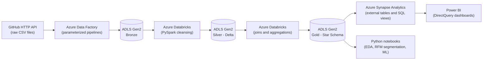

# Azure End-To-End Data Engineering Pipeline + Analytics: AdventureWorks 🚀

An end-to-end data engineering and analytics project that ingests, transforms, and serves AdventureWorks business data using Microsoft Azure's modern data stack. The pipeline follows the **Medallion Architecture** (Bronze, Silver, Gold) to ensure data quality and scalability. On top of the Gold layer, Python notebooks add **data-quality auditing, EDA, customer segmentation, and a predictive model**.

## 🏗️ Architecture Overview



The project implements an end-to-end ETL/ELT pipeline utilizing the following Azure services:
*   **Data Ingestion:** Azure Data Factory (ADF) extracts raw data from an HTTP API (GitHub) and loads it into the Data Lake.
*   **Data Storage:** Azure Data Lake Storage Gen2 (ADLS Gen2) serves as the foundational storage for the Bronze, Silver, and Gold layers.
*   **Data Transformation:** Azure Databricks (using PySpark) cleanses and transforms the data from Bronze (Raw) -> Silver (Cleansed) -> Gold (Aggregated).
*   **Data Warehousing & Serving:** Azure Synapse Analytics hosts the relational data models built with SQL for downstream consumption.
*   **Business Intelligence:** Power BI connects to the Synapse SQL pool for interactive dashboarding and reporting.
*   **Analytics & ML:** Python notebooks (pandas, scikit-learn) run data-quality checks, EDA, RFM customer segmentation, and a repeat-purchase propensity model on the Gold data.

## 🛠️ Technology Stack
*   **Cloud Platform:** Microsoft Azure
*   **Orchestration:** Azure Data Factory (ADF)
*   **Data Lake:** Azure Data Lake Storage (ADLS Gen2)
*   **Big Data Compute:** Azure Databricks (PySpark, Python, Delta Lake)
*   **Data Warehouse:** Azure Synapse Analytics (SQL)
*   **Data Visualization:** Power BI
*   **Analytics & ML:** Python, pandas, NumPy, scikit-learn, matplotlib, seaborn
*   **AI Developer Tools:** GitHub Copilot / Cursor (utilized for rapid pipeline development and documentation)

## ⚙️ Pipeline Execution Flow (Medallion Architecture)

1.  **Ingestion (Source to Bronze):**
    *   Configured linked services and datasets in Azure Data Factory.
    *   Built dynamic pipelines using parameters and loops to fetch raw CSV data from the GitHub API and land it in the `bronze` container in ADLS Gen2 in its raw format.
2.  **Transformation (Bronze to Silver):**
    *   Mounted ADLS Gen2 to Databricks.
    *   Processed the raw data using PySpark. Applied schema validation, dropped duplicates, handled null values, and converted data types.
    *   Saved the cleansed data in Delta format into the `silver` container.
3.  **Aggregation (Silver to Gold):**
    *   Performed business-level aggregations and joins in Databricks.
    *   Structured the data into fact and dimension tables (Star Schema) and pushed the finalized data to the `gold` container.
4.  **Serving (Gold to Synapse):**
    *   Utilized Azure Synapse Analytics to create external tables pointing to the Gold data lake.
    *   Wrote SQL views to serve structured analytics-ready data to downstream BI tools.
5.  **Reporting:**
    *   Connected Power BI directly to Azure Synapse via DirectQuery.
    *   Built interactive KPI dashboards to visualize sales, customer trends, and product performance.
6.  **Analytics & ML:**
    *   Audited data quality, explored the Gold data, segmented customers with RFM + K-Means, and built a repeat-purchase prediction model (details in the Analytics section below).

## 🔍 Data Quality & Lineage

Data quality is handled at every stage, and each cleaning decision is documented in the notebooks.

**Layer-by-layer lineage**

| Layer | Storage | Processing | Data-quality handling |
|---|---|---|---|
| Source | GitHub HTTP API (raw CSV) | Parameterized ADF pipelines with loops | Raw data landed unchanged |
| Bronze | ADLS Gen2 `bronze` container | None (raw copy) | Preserved as the untouched source of truth |
| Silver | ADLS Gen2 `silver` container (Delta) | PySpark in Databricks | Schema validation, duplicate removal, null handling, data-type conversion |
| Gold | ADLS Gen2 `gold` container | PySpark joins and aggregations | Star schema (fact and dimension tables) for analytics |
| Serving | Azure Synapse external tables and SQL views | SQL | Analytics-ready views for BI |
| Reporting | Power BI (DirectQuery) | - | KPI dashboards on sales, customers, and products |

**Audit and monitoring**
*   **Data-quality report:** running `Analytics/01_eda_data_quality.ipynb` generates `audit/data_quality_report.csv`, listing nulls, duplicates, data types, and unique counts for every table, plus integrity checks (missing customers, orphan customer and product keys, non-positive quantities).
*   **Layer audit logging:** `Reference Script/pipeline_data_quality.py` is a Databricks script that logs row counts, duplicate counts, and null counts per table for each layer into an audit Delta table, with a Bronze-to-Silver reconciliation view showing how many rows were removed.

## 📈 Analytics: EDA, Segmentation & Predictive Model

All notebooks are in the `/Analytics` folder. Each has a configuration cell at the top for the data location and table and column names.

| Notebook | What it does |
|---|---|
| `01_eda_data_quality.ipynb` | Data-quality audit and documented cleaning, KPIs (revenue, profit, margin, order value), revenue trend and seasonality, top products and territories, outlier analysis using the IQR rule, and customer revenue concentration |
| `02_rfm_segmentation.ipynb` | Builds Recency, Frequency, and Monetary features, applies log transformation and scaling, selects k using the elbow method and silhouette score, runs K-Means, and profiles and names the customer segments |
| `03_repeat_purchase_model.ipynb` | Predicts which customers will buy again in the next 180 days. Features use only orders **before** a cutoff date to avoid data leakage, and the model is trained on an earlier period and tested on a later one (out-of-time validation). Compares a baseline, Logistic Regression, and Random Forest using ROC-AUC, PR-AUC, precision, and recall, and reports permutation feature importance and top-20% lift |

Segment results can be written back to the Gold layer as a Delta table and exposed to Power BI through a Synapse view (the code is included, commented out, in notebook 02).

## 📂 Repository Structure
```
AdventureWorks-Data-Engineering/
├── Analytics/                      # EDA, segmentation, and ML notebooks
├── Data/                           # Sample schemas or configuration files
├── Reference Script/               # PySpark notebooks and SQL scripts for Databricks and Synapse
│   └── pipeline_data_quality.py    # Row-count, null, and duplicate audit logging per layer
└── README.md
```

## 🚀 How to Run (Prerequisites)
To replicate the data pipeline, you will need:
1.  An active Microsoft Azure Subscription.
2.  Provisioned resources: Resource Group, ADLS Gen2 account, Azure Data Factory, Azure Databricks Workspace, and Azure Synapse workspace.
3.  Appropriate IAM role assignments (e.g., Storage Blob Data Contributor) managed via Managed Identities for secure resource interaction.

To run the analytics notebooks:
1.  Install the libraries: `pip install pandas numpy matplotlib seaborn scikit-learn jupyter`.
2.  Open the configuration cell in each notebook and set the data location (`DATA_DIR` for local CSV files, or `USE_SPARK = True` with `GOLD_PATH` in Databricks) and the table and column names.
3.  Run the notebooks in order: `01` → `02` → `03`.

## ⚠️ Limitations
*   AdventureWorks is a sample dataset, so the insights and model results are illustrative rather than real business outcomes.
*   The propensity model uses purchase-behaviour features only. A production model would add customer attributes, channel, and product-category features, and would tune the decision threshold to campaign cost versus benefit.
